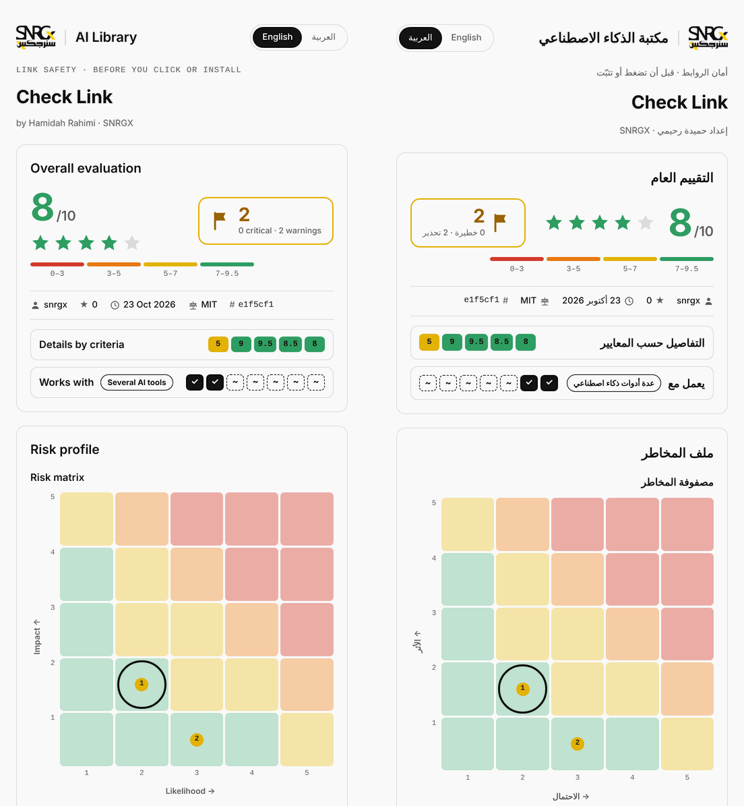

<p>
  <picture>
    <source media="(prefers-color-scheme: dark)" srcset="assets/snrgx-logo-dark.svg">
    
  </picture>
  &nbsp;&nbsp;<b>AI Library</b> · مكتبة الذكاء الاصطناعي
</p>

# SNRGX AI Library

[](plugins/check-link/CHANGELOG.md)
[](LICENSE)
[](#arabic)

**Visual, bilingual AI tools for founders and creators.** Each tool turns expert work into a clear page anyone can read, in English and Arabic.

Built by Hamidah Rahimi (**SNRGX**). [العربية ↓](#arabic)

## 🛡️ Check Link

**Paste a link. See how risky it is, before you install, open or trust it.**

<p align="center"></p>

It works on AI skills, plugins and MCP servers, and on any other link: websites, documents, short links and downloads. Nothing you check is installed, run or downloaded.

## Install (1-minute setup)

Pick **one** route for each AI tool you use. Installing the same skill two ways gives you two copies.

<details>
<summary><strong>Claude Code</strong></summary>

```
/plugin marketplace add snrgx/AI-Library
/plugin install check-link@snrgx
```

To update: `/plugin marketplace update snrgx`.

</details>

<details>
<summary><strong>Claude app</strong> (web and desktop)</summary>

1. Turn on **Settings → Capabilities → Code execution and file creation**.
2. Open the [latest release](https://github.com/snrgx/AI-Library/releases/latest) and download **Source code (zip)**. Keep it zipped.
3. In Claude: **Customize → Skills → + → Upload a skill**, and choose that zip.

To update: upload the newer release the same way.

</details>

<details>
<summary><strong>OpenAI Codex</strong></summary>

```bash
codex plugin marketplace add snrgx/AI-Library
codex plugin add check-link@snrgx
```

</details>

<details>
<summary><strong>GitHub Copilot</strong> (CLI)</summary>

```bash
copilot plugin marketplace add snrgx/AI-Library
copilot plugin install check-link@snrgx
```

</details>

<details>
<summary><strong>Gemini CLI</strong></summary>

```bash
gemini skills install https://github.com/snrgx/AI-Library.git --path plugins/check-link/skills
```

To update: run the same command again.

</details>

<details>
<summary><strong>Cursor, Windsurf, OpenCode and other agents</strong></summary>

```bash
npx skills@1.7.4 add snrgx/AI-Library --skill check-link -a <agent>
```

Replace `<agent>` with your tool (for example `cursor`), or leave out `-a <agent>` to choose from a list. To update: `npx skills@1.7.4 update check-link`.

</details>

**Prefer a reviewed, fixed version?** Every release is tagged (for example `check-link-v1.6.0`) on the [Releases](https://github.com/snrgx/AI-Library/releases) page.

**Coming soon:** Check Link online, in your browser with nothing to install.

## Use it

1. **Paste a link** and ask: *"Check this link before I install it."* In Claude Code you can also type `/check-link:check-link <link>`.
2. **Read the visual report.** In the Claude app it arrives in the chat; elsewhere it's saved as an HTML file you open in your browser. Switch between English and Arabic at the top.
3. **Follow the checklist.** Tick the steps you want, then copy the ready prompt to your AI assistant.

## Why Check Link

**A skill is instructions your AI follows.** A plugin can run code on your computer. A bad one can hide instructions, read your passwords or keys, or send your data somewhere. Check Link reads it **without running it** and shows red flags with the exact file and line.

**Links can pretend.** Look-alike addresses, pages that ask for a password or card, short links that hide where they go. Check Link spots them, including look-alikes of Kuwaiti banks and delivery services, and only follows a short link after you agree.

**Security reports are hard to read.** So Check Link gives you a page instead of a wall of text:

- **Score out of 10** with stars, and a **Low / Medium / High** risk level (never "safe": nothing is risk-free)
- **Risk matrix** (likelihood × impact) and **what it can do**: reads private data, sends data out, runs code
- **OWASP Agentic Skills Top 10** and **which AI tools it works with**
- A **Before you install** or **Before you open** checklist with a ready prompt

## All tools

| Tool | What it does | Version |
|---|---|---|
| 🛡️ [**Check Link**](plugins/check-link) | Visual trust check for any link: AI skills, plugins, MCP servers, websites, documents, short links and downloads. | [v1.6.1](plugins/check-link/CHANGELOG.md) |

More tools are on the way. Each one gets its own folder, version and install line above.

<details>
<summary><strong>Library structure</strong> (for builders)</summary>

```
AI-Library/
├── .claude-plugin/marketplace.json   the catalog: every tool in the library
├── README.md                         this page
├── LICENSE · SECURITY.md             rules for the whole library
├── assets/                           SNRGX logos and previews
├── templates/plugin-starter/         the starting shape for a new tool (not installable)
└── plugins/
    └── check-link/                   everything for Check Link
        ├── .claude-plugin/plugin.json   name, version, icon
        ├── README.md · CHANGELOG.md · LICENSE · SECURITY.md
        └── skills/check-link/        SKILL.md · references/ · assets/report-template.html
```

Add the library once, then install only the tools you want, each by name: `<tool>@snrgx`. Every tool has its own version and release tag, so updating one never changes another. To add a tool, see [templates/README.md](templates/README.md).

</details>

## Safety

Every tool here is checked with Check Link by its author before release. That's our own review, not an independent audit or a guarantee. Found a problem? See [SECURITY.md](SECURITY.md).

---

<div dir="rtl">

<a id="arabic"></a>

## مكتبة SNRGX للذكاء الاصطناعي

**أدوات ذكاء اصطناعي مرئية وثنائية اللغة لروّاد الأعمال وصنّاع المحتوى.** كل أداة تحوّل عمل الخبراء إلى صفحة واضحة يقرؤها أي شخص، بالعربية والإنجليزية.

### 🛡️ Check Link

**الصق الرابط، واعرف مستوى خطورته قبل أن تثبّته أو تفتحه أو تثق به.**

يعمل على المهارات والإضافات وخوادم MCP، وعلى أي رابط آخر: المواقع والمستندات والروابط المختصرة وروابط التحميل. لا يتم تثبيت أو تشغيل أو تحميل أي شيء تفحصه.

### التثبيت (دقيقة واحدة)

اختر طريقة **واحدة** لكل أداة ذكاء اصطناعي تستخدمها، فالتثبيت بطريقتين يعطيك نسختين.

<details>
<summary><strong>Claude Code</strong></summary>

<div dir="ltr">

```
/plugin marketplace add snrgx/AI-Library
/plugin install check-link@snrgx
```

</div>

للتحديث: ‎`/plugin marketplace update snrgx`‎

</details>

<details>
<summary><strong>تطبيق Claude</strong> (الموقع وتطبيق الكمبيوتر)</summary>

1. فعّل «تنفيذ الأكواد وإنشاء الملفات» من الإعدادات ← الإمكانات.
2. افتح [آخر إصدار](https://github.com/snrgx/AI-Library/releases/latest) وحمّل **Source code (zip)**، واتركه مضغوطاً.
3. في Claude: تخصيص ← المهارات ← + ← رفع مهارة، واختر الملف.

للتحديث: ارفع الإصدار الأحدث بالطريقة نفسها.

</details>

<details>
<summary><strong>OpenAI Codex</strong></summary>

<div dir="ltr">

```bash
codex plugin marketplace add snrgx/AI-Library
codex plugin add check-link@snrgx
```

</div>
</details>

<details>
<summary><strong>GitHub Copilot</strong></summary>

<div dir="ltr">

```bash
copilot plugin marketplace add snrgx/AI-Library
copilot plugin install check-link@snrgx
```

</div>
</details>

<details>
<summary><strong>Gemini CLI</strong></summary>

<div dir="ltr">

```bash
gemini skills install https://github.com/snrgx/AI-Library.git --path plugins/check-link/skills
```

</div>

للتحديث: شغّل الأمر نفسه مرة أخرى.

</details>

<details>
<summary><strong>Cursor وWindsurf وOpenCode وغيرها</strong></summary>

<div dir="ltr">

```bash
npx skills@1.7.4 add snrgx/AI-Library --skill check-link -a <agent>
```

</div>

ضع اسم أداتك مكان ‎`<agent>`‎ (مثل ‎`cursor`‎)، أو احذف ‎`-a <agent>`‎ لتختار من قائمة. للتحديث: ‎`npx skills@1.7.4 update check-link`‎

</details>

**تفضّل نسخة ثابتة تمت مراجعتها؟** لكل إصدار وسم خاص (مثل ‎`check-link-v1.6.0`‎) في صفحة [Releases](https://github.com/snrgx/AI-Library/releases).

**قريباً:** Check Link على الإنترنت، في متصفحك دون أي تثبيت.

### طريقة الاستخدام

1. **الصق الرابط** واكتب: «افحص هذا الرابط قبل أن أثبّته».
2. **اقرأ التقرير المرئي.** في تطبيق Claude يصلك في المحادثة، وفي غيره يُحفظ كملف HTML تفتحه في المتصفح. بدّل بين العربية والإنجليزية من الأعلى.
3. **اتبع قائمة التحقق.** اختر الخطوات التي تريدها، ثم انسخ الأمر الجاهز إلى مساعدك الذكي.

### لماذا Check Link؟

**المهارة تعليمات ينفّذها مساعدك الذكي،** والإضافة قد تشغّل أكواداً على جهازك. والسيئة منها قد تخفي تعليمات، أو تقرأ كلمات المرور والمفاتيح، أو ترسل بياناتك. Check Link يقرؤها **دون تشغيلها** ويبيّن علامات الخطر مع الملف والسطر.

**الروابط قد تتنكّر:** عناوين مقلّدة، وصفحات تطلب كلمة المرور أو البطاقة، وروابط مختصرة تخفي وجهتها. Check Link يكشفها، ومنها تقليد البنوك وشركات التوصيل في الكويت، ولا يفتح الرابط المختصر إلا بعد موافقتك.

**تقارير الأمان صعبة القراءة،** لذلك يعطيك Check Link صفحة واضحة: تقييم من 10 مع نجوم، ومستوى المخاطر (منخفضة، متوسطة، عالية، ولا نقول «آمن» أبداً)، ومصفوفة المخاطر، وما يستطيع فعله، وقائمة OWASP، والأدوات التي يعمل معها، وقائمة «قبل التثبيت» أو «قبل الفتح» مع أمر جاهز.

### الأمان

تُفحص كل أداة هنا بـ Check Link من قِبل صاحبتها قبل نشرها. هذه مراجعتنا نحن، وليست تدقيقاً مستقلاً ولا ضماناً. وجدت مشكلة؟ راجع [SECURITY.md](SECURITY.md).

</div>

---

Created by **Hamidah Rahimi** ([@hamidahrk](https://github.com/hamidahrk)) · **SNRGX** ([@snrgx](https://github.com/snrgx)). License: MIT (see [LICENSE](LICENSE); each tool also carries its own license file).
